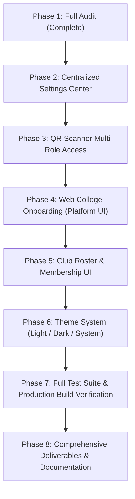

# CampusPulse — Product Implementation Plan

**Date:** 2026-11-24  
**Repository:** `C:\Users\singh\OneDrive\Desktop\CAMPUSPULSE`  
**Git Branch:** `main`  
**Strategy:** Systematic feature completion, zero dead ends, full backwards compatibility, and strict preservation of production Neon data.

---

## Roadmap & Implementation Phases

---

## Phase 2: Centralized Settings Center & Security Center

### Goals:

Transform `/account` into a comprehensive, multi-tab or organized settings center that serves all four roles seamlessly.

### Tasks:

1. **Change Password Form:**
   - Create `changePasswordAction` in `src/features/auth/actions.ts`.
   - Requires `currentPassword`, `newPassword`, `confirmPassword`.
   - Uses `verifyPassword` to validate current password before hashing the new password with Argon2id.
   - Updates `Account` record and audits `PASSWORD_CHANGED`.
   - Renders a clean form in `src/app/account/page.tsx` with error and success states.
2. **Active Sessions Management:**
   - Create query `getUserSessions(userId)` to fetch active sessions from `Session` model (`id`, `createdAt`, `expiresAt`, `ipAddress`, `userAgent`).
   - Create `revokeSessionAction(sessionId)` to let users terminate any session other than their current one.
   - Display active sessions table on `/account` with "Current session" badge and "Revoke" button.
3. **Integrated Notification Preferences:**
   - Embed `NotificationPreferenceForm` into `/account` so all roles can toggle in-app alerts directly from settings.
4. **Appearance & Theme Settings:**
   - Embed theme selector (Light, Dark, System) with live preview and persistent client-side state.
5. **Sidebar Navigation Updates:**
   - In `src/app/student/layout.tsx`, add `{ href: "/account", label: "Settings", icon: "settings", group: "You" }`.
   - In `src/components/dashboard/dashboard-shell.tsx`, make the user profile block at the bottom of the sidebar clickable, directly linking to `/account`.

---

## Phase 3: QR Scanner Multi-Role Accessibility

### Goals:

Allow `SUPER_ADMIN` and `COLLEGE_ADMIN` to access event attendance and the QR scanner without being blocked or redirected away.

### Tasks:

1. **Update Route Guard:**
   - In `src/app/club/layout.tsx` and `src/app/club/attendance/page.tsx`, allow `SUPER_ADMIN` and `COLLEGE_ADMIN` (from the same college) to view `/club/attendance`.
2. **Update Dashboard Queries:**
   - In `src/server/dashboards/queries.ts` (`getClubAttendance` and `getClubWorkspace`), if the actor is `SUPER_ADMIN` or `COLLEGE_ADMIN`, bypass the strict `CLUB_ADMIN` role assertion and load the requested club (or college's first club).
3. **Cross-Link in College Events:**
   - In `src/app/college/events/[eventId]/page.tsx`, add an "Attendance & QR Scanner" button linking directly to `/club/attendance?club=${event.clubId}&eventId=${event.id}`.

---

## Phase 4: Web College Onboarding in Platform Dashboard

### Goals:

Allow Super Admins to create and onboard a new college tenant directly within `/platform/colleges` via the web UI.

### Tasks:

1. **Server Action:**
   - Create `createCollegeAction` in `src/features/dashboards/actions.ts`.
   - Validates input (`name`, `slug`, `shortName`, `primaryDomain`, `timezone`).
   - Verifies caller has `SUPER_ADMIN` role.
   - Inserts record into `colleges` table and logs audit event `COLLEGE_CREATED`.
2. **Frontend Component:**
   - Create `CreateCollegeDialog` / form on `src/app/platform/colleges/page.tsx`.
   - Includes validation for unique slug and primary domain.

---

## Phase 5: Club Roster & Membership Management

### Goals:

Provide visible club membership and manager details inside `/club/settings`.

### Tasks:

1. **Query Update:**
   - In `getClubSettings`, fetch active club memberships (`user.name`, `user.email`, `role`, `joinedAt`).
2. **UI Component:**
   - Display a "Club Leadership & Officers" card in `/club/settings` showing current presidents and officers.

---

## Phase 6: Full Theme System (Light / Dark / System)

### Goals:

Implement a dark theme that adheres to CampusPulse's campus-paper identity.

### Tasks:

1. **CSS Variables in `globals.css`:**
   - Add dark mode CSS tokens under `html[data-theme="dark"]` and `html.dark`.
2. **Theme Script in `layout.tsx`:**
   - Inject inline script into `src/app/layout.tsx` to read `localStorage.getItem("campuspulse-theme")` before render to prevent theme flashing.
3. **Theme Switcher Component:**
   - Create `ThemeSelector` component with buttons for Light, Dark, and System.

---

## Phase 7: Verification & Build

### Goals:

Confirm complete health and reliability across the platform.

### Tasks:

1. Run `npm run typecheck` (`tsc --noEmit`).
2. Run `npm run test:db` (All 243+ Vitest unit/integration tests).
3. Run `npm run build` to verify Next.js production compilation.

---

## Phase 8: Deliverables & Documentation

### Goals:

Deliver all 10 master documentation artifacts required by Phase 12.
