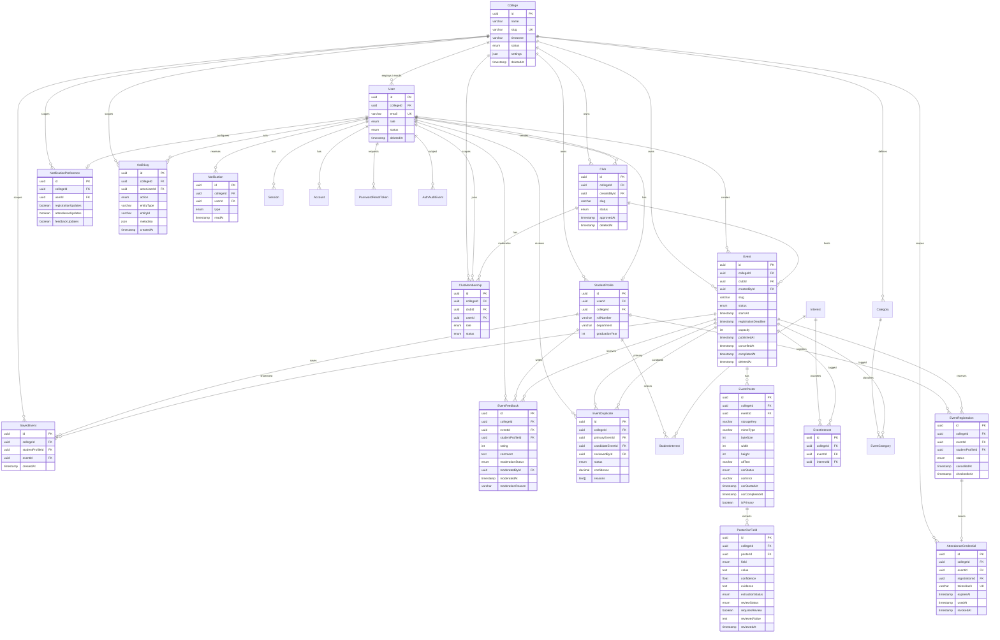

# CampusPulse database architecture

This document describes the PostgreSQL/Prisma layer through Event Operations. The
database includes Better Auth session/account tables, custom reset, rate-limit,
and anonymous auth-audit tables, persistent saved events for the student
dashboard, poster metadata and audit actions, transactional in-app
notifications for event moderation and registration changes, the Event Intelligence
event-intelligence tables for OCR review, event interests, and advisory
duplicate review, and the Event attendance-credential and notification-
preference tables plus feedback moderation fields. The business services and
dashboard queries remain server-only building blocks and are not exposed through
public business API routes; auth, dashboard mutations, and authenticated
downloads run through Server Actions or route handlers. Poster bytes live in the
configured storage adapter, not in PostgreSQL; see `docs/poster-storage.md`.
See `docs/event-intelligence.md` and `docs/attendance-feedback-analytics.md` for
OCR, recommendation, duplicate, schedule-conflict, attendance, feedback,
calendar, export, and analytics behavior.

## 1. Design principles

- **Explicit tenancy.** Every tenant-owned row carries `collegeId`.
- **Database-enforced relationships.** Composite foreign keys include
  `collegeId`, so a club, event, registration, or membership cannot point at a
  parent in another college.
- **Server-derived identity.** Services accept a trusted `AuthenticatedActor`
  derived from a verified session, then reload the actor's role, college, and
  club memberships from PostgreSQL. They never accept `actorUserId`, `role`,
  `collegeId`, `clubId` ownership, or event ownership from a browser.
- **Atomic business actions.** Event transitions, registration changes, club
  decisions, role changes, poster metadata swaps, in-app notifications, and
  their audit records share one transaction. Poster bytes are written first and
  cleaned up if the database transaction fails.
- **Fail closed.** Missing/invalid tenant context and unsafe test/seed targets
  throw instead of falling back to another college or database.
- **No credential logging.** Configuration errors log field names, never values.
  Audit metadata is recursively redacted and size-bounded.

## 2. Models

The schema has 27 models. The 21 business models are:

| Model                    | Purpose                                         | Tenant key                                |
| ------------------------ | ----------------------------------------------- | ----------------------------------------- |
| `College`                | Tenant root and settings                        | own `id`                                  |
| `User`                   | Student, club admin, college admin, super admin | `collegeId` nullable for platform admins  |
| `StudentProfile`         | Student identity within a college               | `collegeId`                               |
| `Club`                   | Student organization                            | `collegeId`                               |
| `ClubMembership`         | User membership and club role                   | `collegeId`                               |
| `Interest`               | Platform-wide interest taxonomy                 | global                                    |
| `StudentInterest`        | Student-interest join                           | `collegeId`                               |
| `SavedEvent`             | Persistent student event shortlist              | `collegeId`                               |
| `Category`               | College-specific event category                 | `collegeId`                               |
| `Event`                  | Event and lifecycle state                       | `collegeId`                               |
| `EventCategory`          | Event-category join                             | `collegeId`                               |
| `EventInterest`          | Event-interest join for recommendations         | `collegeId`                               |
| `EventRegistration`      | Student registration                            | `collegeId`                               |
| `AttendanceCredential`   | Event-bound hashed QR check-in credential       | `collegeId`                               |
| `EventPoster`            | Poster metadata, dimensions, and OCR state      | `collegeId`                               |
| `PosterOcrField`         | Per-field OCR extraction and human review       | `collegeId`                               |
| `EventFeedback`          | Post-event feedback and moderation state        | `collegeId`                               |
| `Notification`           | User notification                               | `collegeId`                               |
| `NotificationPreference` | Per-user optional in-app notification settings  | `collegeId`                               |
| `EventDuplicate`         | Moderation duplicate candidate                  | `collegeId`                               |
| `AuditLog`               | Immutable-by-convention audit trail             | `collegeId` nullable for platform actions |

The six auth/security models are:

| Model                | Purpose                                  | Scope                                     |
| -------------------- | ---------------------------------------- | ----------------------------------------- |
| `Session`            | Better Auth database session             | user-scoped                               |
| `Account`            | Better Auth credential/provider account  | user-scoped                               |
| `Verification`       | Better Auth verification record          | optional user/identifier                  |
| `PasswordResetToken` | SHA-256 hash of a single-use reset token | user-scoped, expires after 30 minutes     |
| `RateLimitEntry`     | HMAC-keyed PostgreSQL rate-limit bucket  | global, fixed window                      |
| `AuthAuditEvent`     | Anonymous/known-user auth audit event    | optional user/college; HMAC email/IP keys |

The auth migration also adds `User.emailVerified`, `User.image`, and the
`AuthAuditEventType` enum. `Account.password` stores Argon2id PHC hashes; there is
no plaintext password or raw reset-token column.

Important constraints beyond Prisma's model language are in
`prisma/migrations/20261105044302_init/migration.sql`:

- positive event capacity;
- registration-window ordering and deadline before start;
- online events require a URL;
- published, rejected, cancelled, and completed timestamps required;
- cancelled registrations require `cancelledAt`;
- attended registrations require `checkedInAt`;
- feedback ratings from 1 to 5;
- positive poster byte size and `image/*` MIME type;
- duplicate records cannot reference themselves and confidence is 0–1;
- one primary poster per event (partial unique index);
- one interest link per event and one OCR row per poster/field.

The audit enum was extended by
`prisma/migrations/20261105045947_audit_event_actions/migration.sql` with
`EVENT_CREATED` and `EVENT_UPDATED`. The additive
`prisma/migrations/20261109081554_auth_sessions_rbac/migration.sql` adds the auth
tables, `User` auth fields, `AuthAuditEventType`, and rate-limit/reset indexes
without resetting existing data. The additive
`prisma/migrations/20261110000000_dashboard_saved_events/migration.sql` adds the
`saved_events` table, its composite tenant foreign keys and unique pair, and the
`SAVED_EVENT_CHANGED` and `NOTIFICATION_READ` audit actions. The additive
`prisma/migrations/20261111000000_poster_audit/migration.sql` extends
`AuditAction` with `POSTER_UPLOADED`, `POSTER_REPLACED`, and `POSTER_REMOVED`.
The additive
`prisma/migrations/20261113000000_event_intelligence/migration.sql` adds
the OCR enums, `event_interests`, `poster_ocr_fields`, OCR timestamps/error and
composite poster uniqueness, and duplicate review reasons/indexes. The additive
`prisma/migrations/20261115000000_event_operations/migration.sql` adds
`attendance_credentials` and `notification_preferences`, feedback moderation
fields and index, the `FeedbackModerationStatus` enum, attendance/feedback/
preference audit actions, `ATTENDANCE_UPDATE`/`FEEDBACK_UPDATE` notification
types, a registration tenant index, and notification type indexes. Existing
migrations and rows are untouched.

## 3. ER diagram



## 4. Tenant isolation

### What the database enforces

Tenant-owned relationships use composite foreign keys. Examples:

```sql
-- events -> clubs
FOREIGN KEY ("clubId", "collegeId") REFERENCES "clubs"("id", "collegeId")

-- event_registrations -> events and student_profiles
FOREIGN KEY ("eventId", "collegeId") REFERENCES "events"("id", "collegeId")
FOREIGN KEY ("studentProfileId", "collegeId")
  REFERENCES "student_profiles"("id", "collegeId")

-- club_memberships -> clubs and users
FOREIGN KEY ("clubId", "collegeId") REFERENCES "clubs"("id", "collegeId")
FOREIGN KEY ("userId", "collegeId") REFERENCES "users"("id", "collegeId")
```

These constraints make cross-college parent/child rows invalid even if an
application bug omits a `WHERE collegeId = ...` predicate.

### What the application enforces

- `loadActor()` loads the user, active status, college, and active club
  memberships from the database.
- Event transitions, registrations, club decisions, and role changes derive the
  tenant from the actor or the target row, never from a browser-supplied
  `collegeId`.
- Registration locks the event row using the student profile's `collegeId`.
- Cross-tenant registration lookups return `TenantIsolationError`; management
  services reject unauthorized actors without returning tenant data. Object
  existence is not fully normalized across tenant boundaries (a low-risk
  enumeration signal).
- Tenant context helpers use a per-call object; there is no mutable global
  tenant state.
- Event creation is club-manager-only. The `events_createdById_collegeId_fkey`
  composite foreign key requires the creator to belong to the event's college,
  so a platform administrator with no college cannot be the creator. Platform
  administrators can still review and transition existing events across
  colleges and approve clubs.

### Important limitation

**PostgreSQL Row-Level Security (RLS) is not implemented.** Composite foreign
keys and explicit service scoping are not a substitute for RLS. A compromised
application process, a direct database connection, or a future route that
bypasses the services could access another tenant's data. RLS should be added
before production multi-tenant deployment, with transaction-scoped
`SET LOCAL app.college_id` and policies on every tenant-owned table.

Composite foreign keys protect **database relationships**. They do not
authorize API requests. Application code must independently enforce authentication and
application-layer authorization on every route.

## 5. Event lifecycle

The explicit state machine lives in `src/services/events.ts`:

```text
DRAFT ───────────────► PENDING_APPROVAL
                         │       │       │
                         │       │       └──► CANCELLED
                         │       └──────────► REJECTED ──► DRAFT
                         └──────────────────► PUBLISHED
                                                  │   │
                                                  │   └──► COMPLETED
                                                  └──────► CANCELLED

CANCELLED and COMPLETED are terminal.
```

| Transition                       | Club admin (own active club) | College admin (own college) | Super admin |
| -------------------------------- | ---------------------------- | --------------------------- | ----------- |
| `DRAFT → PENDING_APPROVAL`       | yes                          | yes                         | yes         |
| `PENDING_APPROVAL → PUBLISHED`   | no                           | yes                         | yes         |
| `PENDING_APPROVAL → REJECTED`    | no                           | yes                         | yes         |
| `PENDING_APPROVAL → CANCELLED`   | yes                          | yes                         | yes         |
| `REJECTED → DRAFT`               | yes                          | yes                         | yes         |
| `PUBLISHED → CANCELLED`          | yes                          | yes                         | yes         |
| `PUBLISHED → COMPLETED`          | yes                          | yes                         | yes         |
| Any terminal outgoing transition | no                           | no                          | no          |

Additional transitions were added only for operational needs:

- `PENDING_APPROVAL → CANCELLED` lets a club withdraw before review.
- `PUBLISHED → COMPLETED` records that a published event finished.

There is deliberately no `CANCELLED → PUBLISHED`, `COMPLETED → PUBLISHED`, or
`PENDING_APPROVAL → DRAFT` shortcut because those would hide history or bypass
review. A rejected event must return to `DRAFT` before resubmission.

The transition uses an `updateMany` guarded by the expected current status. If a
concurrent actor changed the event first, the update count is zero and a
`CONFLICT` domain error is returned. Cancelling an event also cancels all
`CONFIRMED` registrations and creates cancellation notifications for those
students in the same transaction. Approval and rejection create notifications
for active club managers in the same transaction. The audit record is written
inside that transaction.

Poster management follows the same lifecycle: upload/replace/remove is allowed
for `DRAFT`, `REJECTED`, and `PUBLISHED`, and locked for `PENDING_APPROVAL`,
`CANCELLED`, and `COMPLETED`. The poster row and its audit action share one
transaction; the file write precedes the transaction and is cleaned up if the
transaction fails. See `docs/event-operations.md` and
`docs/poster-storage.md`.

## 6. Registration concurrency

`src/services/registrations.ts` prevents overbooking with a PostgreSQL row lock:

1. Load the student profile from the database. The profile supplies the college.
2. Start a Prisma interactive transaction.
3. Execute parameterized SQL:
   ```sql
   SELECT "id"
   FROM "events"
   WHERE "id" = $1::uuid
     AND "collegeId" = $2::uuid
     AND "deletedAt" IS NULL
   FOR UPDATE;
   ```
4. Read the event and verify `PUBLISHED`, active club, start time, opening time,
   deadline, and capacity.
5. Count active registrations (`CONFIRMED` + `ATTENDED`) while the event row is
   locked.
6. Revalidate schedule conflicts against the student's active registrations in
   the same college. The conflict list is advisory, returned to the caller, and
   written to audit metadata; the current rules do not block registration.
7. Insert or reactivate the registration.
8. Write the confirmation notification and audit record in the same transaction.

The event row is the serialization point. Two simultaneous registration
transactions for the same event cannot both count the pre-insert state and then
insert past capacity: the second transaction blocks on `FOR UPDATE` until the
first commits, then counts the new row.

Additional protection:

- `@@unique([eventId, studentProfileId])` prevents duplicate rows.
- Prisma `P2002` unique errors are translated to `ALREADY_REGISTERED`.
- `P2034` serialization/deadlock errors are retried up to three times.
- A cancelled registration may be reactivated only when the event is still open
  and capacity remains.
- Cancellation writes the cancellation notification and audit record in the same
  transaction and is guarded by the current `CONFIRMED` status, so a repeated
  cancellation cannot create a duplicate notification.
- Capacity is never checked only in the browser or only in a pre-insert count.

The transaction options are `maxWait: 5000` and `timeout: 10000`. The
concurrency test starts four or more registrations at once against capacity 1
and asserts exactly one `CONFIRMED` row.

## 7. Audit logging

`src/server/db/audit.ts` provides:

- `writeAuditLog(tx, input)` — must be called inside the business transaction.
- `redactAuditMetadata(value)` — recursively redacts keys matching password,
  secret, token, authorization, cookie, API key, credential, or session;
  truncates strings at 500 characters; limits depth and key count.

Actions currently written by services:

| Action                             | Trigger                                              |
| ---------------------------------- | ---------------------------------------------------- |
| `EVENT_CREATED`                    | `createEventDraft`                                   |
| `EVENT_UPDATED`                    | `updateEvent`, including accepted poster OCR fields  |
| `EVENT_APPROVED`                   | `PENDING_APPROVAL → PUBLISHED`                       |
| `EVENT_REJECTED`                   | `PENDING_APPROVAL → REJECTED`                        |
| `EVENT_CANCELLED`                  | any allowed transition to `CANCELLED`                |
| `EVENT_STATUS_CHANGED`             | other allowed lifecycle transitions                  |
| `POSTER_UPLOADED`                  | first primary poster upload                          |
| `POSTER_REPLACED`                  | replacement of an existing primary poster            |
| `POSTER_REMOVED`                   | removal of an existing primary poster                |
| `CLUB_APPROVED` / `CLUB_REJECTED`  | `decideClub`                                         |
| `CLUB_UPDATED`                     | `updateClubProfile`                                  |
| `USER_ROLE_CHANGED`                | `changeUserRole`                                     |
| `USER_STATUS_CHANGED`              | `changeUserStatus`                                   |
| `USER_PROFILE_UPDATED`             | `updateStudentProfile`                               |
| `COLLEGE_UPDATED`                  | college settings/lifecycle changes                   |
| `SAVED_EVENT_CHANGED`              | save/unsave event                                    |
| `NOTIFICATION_READ`                | mark one/all notifications read                      |
| `REGISTRATION_STATUS_CHANGED`      | registration, reactivation, cancellation, attendance |
| `ATTENDANCE_RECORDED`              | manual attendance/no-show recording                  |
| `ATTENDANCE_CORRECTED`             | reasoned attendance correction                       |
| `ATTENDANCE_CREDENTIAL_ISSUED`     | QR credential issuance or rotation                   |
| `FEEDBACK_SUBMITTED`               | student submits feedback                             |
| `FEEDBACK_UPDATED`                 | student edits feedback                               |
| `FEEDBACK_MODERATED`               | hide/restore feedback with a reason                  |
| `NOTIFICATION_PREFERENCES_UPDATED` | optional in-app notification settings changed        |
| `DUPLICATE_CONFIRMED`              | advisory duplicate review confirmed                  |
| `DUPLICATE_DISMISSED`              | advisory duplicate review dismissed                  |

Audit rows record `actorUserId`, action, `entityType`, `entityId`, optional
`collegeId`, redacted metadata, and `createdAt`. No service exposes update or
delete operations for `AuditLog`. Database superusers can still modify rows;
database-level immutability is a future hardening item.

## 8. Test database safety

- `TEST_DATABASE_URL` is separate from `DATABASE_URL`.
- The test database name must be exactly `campuspulse_test`.
- The test host must be local (`localhost`, `127.0.0.1`, `::1`).
- `tests/setup.ts` rewrites `DATABASE_URL` to the test URL before importing the
  application client.
- `tests/helpers/db.ts` checks `current_database()` before `TRUNCATE`.
- `tests/global-setup.ts` creates the database if needed and runs
  `prisma migrate deploy` with the test URL.
- The seed refuses `NODE_ENV=production`, the test database, and remote hosts.

## 9. Migration workflow

```powershell
npm run db:validate
npm run db:generate
npm run db:migrate        # development: create/apply migration
npm run db:migrate:deploy # CI/production-style: apply existing migrations
npx prisma migrate status
```

The Prisma CLI uses `DIRECT_URL` (see `prisma.config.ts`). The Next.js runtime
uses `DATABASE_URL`. Locally both point at the Docker database on port 5434.
In a hosted environment, `DATABASE_URL` should be the pooled connection and
`DIRECT_URL` the direct migration connection.

## 10. Security limitations and follow-ups

- Authentication and database sessions are implemented in Authentication & RBAC. Services
  require a trusted `AuthenticatedActor`; no public business route currently
  accepts an actor identifier from a request body.
- RLS is not implemented. Application-layer scoping and composite foreign keys
  are the current tenant boundary; they do not authorize API requests by
  themselves.
- Auth and dashboard mutations have CSRF/origin checks; auth mutations also use
  PostgreSQL rate limiting. Authenticated download routes re-check session,
  role, and tenant scope. Public business APIs remain unimplemented; poster
  uploads are content-validated and stored outside PostgreSQL.
- SMTP is not configured; production password recovery is not operational here.
- Audit immutability is application-level only.
- The seed uses local-only Docker credentials and fictional data. It is not a
  production seeding mechanism.
- Direct database access bypasses all service rules; production database roles
  must be least-privilege.
